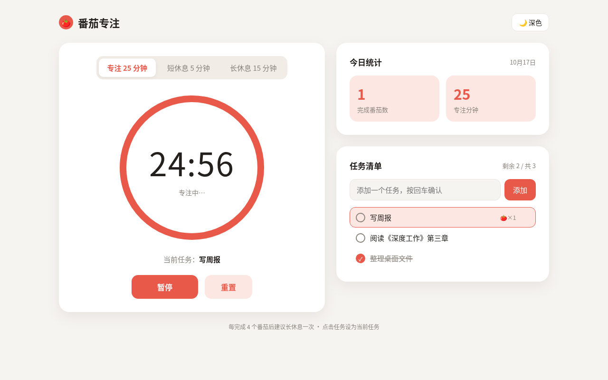
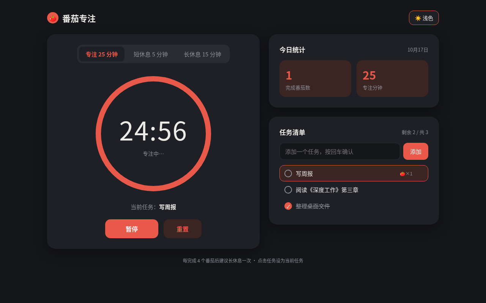

# 番茄专注

一个简洁优雅的番茄工作法计时器，帮助你保持专注，高效完成任务。

## 截图

### 浅色主题

### 深色主题

## 功能特性

- **三种计时模式**
  - 专注模式：25 分钟
  - 短休息：5 分钟
  - 长休息：15 分钟

- **圆环进度计时**
  - 直观的环形进度显示
  - 实时倒计时
  - 标题栏显示剩余时间

- **任务清单管理**
  - 添加、完成、删除任务
  - 每个任务记录完成的番茄数
  - 点击任务设为当前任务

- **今日统计**
  - 完成番茄数统计
  - 专注时长统计
  - 数据自动按日期更新

- **智能提醒**
  - 结束提示音
  - 桌面通知支持
  - 每完成 4 个番茄自动切换到长休息

- **本地存储**
  - localStorage 持久化
  - 自动保存所有数据
  - 刷新页面不丢失进度

- **便捷操作**
  - 空格键快速开始/暂停
  - 深浅色主题切换
  - 响应式设计，适配各种屏幕

## 使用方法

### 本地使用

直接在浏览器中打开 `index.html` 文件即可使用，无需任何依赖或安装。

### 在线访问

启用 GitHub Pages：

1. 进入仓库的 Settings 页面
2. 找到 Pages 选项
3. 在 Source 中选择 `main` 分支
4. 保存后即可通过 GitHub Pages 访问

## 工作原理

番茄工作法（Pomodoro Technique）是一种时间管理方法：

1. 选择一个要完成的任务
2. 设置番茄钟为 25 分钟
3. 专注工作，直到番茄钟响铃
4. 短暂休息 5 分钟
5. 每完成 4 个番茄时段，进行一次较长时间的休息（15 分钟）

## 技术栈

- 纯 HTML + CSS + JavaScript
- 无外部依赖
- 使用 localStorage 存储数据
- 使用 Web Audio API 播放提示音
- 使用 Notification API 发送桌面通知

## 浏览器兼容性

支持所有现代浏览器（Chrome、Firefox、Safari、Edge）

## 许可证

本项目采用 MIT 许可证，详见 [LICENSE](LICENSE) 文件。

Copyright © 2026 jacktou
